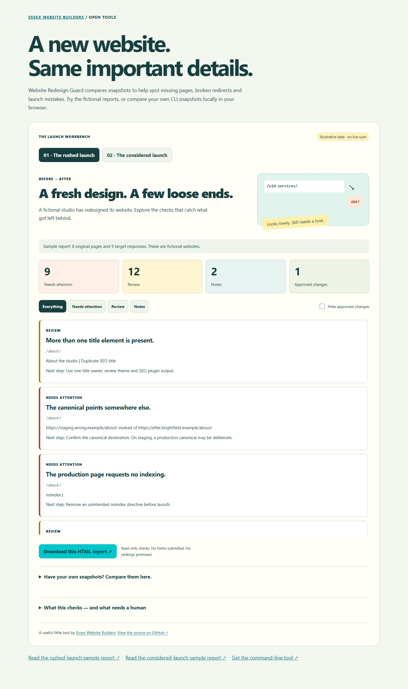

# Website Redesign Guard

**A new website should keep its important details.**

Read-only, open-source checks for website redesigns and WordPress migrations. Capture an original website, compare the replacement, and get an HTML report explaining what needs attention.

[Try the interactive demo](https://essexwebsitebuilders.co.uk/tools/website-redesign-guard/) · [Essex Website Builders](https://essexwebsitebuilders.co.uk/) · [Manual launch checklist](docs/launch-checklist.md)



## What it helps you find

- Old routes that disappeared or redirect to the wrong destination.
- Missing redirects for your explicit URL mappings, including destination checks.
- Redirect loops, chains and temporary redirects that need review.
- Production `noindex` directives, conflicting titles and unexpected canonicals.
- Significant reductions in text available in source HTML.
- Enquiry forms and telephone/email links no longer found in the HTML.
- Missing form labels, fetched internal links returning 404/410, and selected broken images.
- Deliberate 404/410 retirements and approved copy/contact changes.

This is a focused launch checker, not a ranking score. A clean report does not prove Google indexing, full accessibility, working payments or email delivery. [Read the limitations](#coverage-and-limitations).

## Quick start

Requires **Node.js 22 or later**. No paid API, WordPress administrator access or account is needed.

```sh
git clone https://github.com/mahdigroup/website-redesign-guard.git
cd website-redesign-guard
npm ci
```

Capture the original while it is still available:

```sh
node bin/guard.js snapshot \
  --url https://old.example/ \
  --out reports/before.json
```

Compare the replacement:

```sh
node bin/guard.js compare \
  --before reports/before.json \
  --url https://new.example/ \
  --out reports/redesign.html \
  --json reports/findings.json \
  --save-after reports/after.json
```

Open `reports/redesign.html` in your browser. It is self-contained, printable, has no trackers, and makes no network requests. Reports are ignored by Git by default.

You can also open the two snapshot files in the [demo](https://essexwebsitebuilders.co.uk/tools/website-redesign-guard/). Comparison happens locally in your browser; the files are not uploaded.

### Try a fictional example without scanning a website

```sh
node bin/guard.js analyse \
  --before examples/before.json \
  --after examples/broken.json \
  --config examples/changes.json \
  --out reports/example.html
```

The example intentionally has errors, so the command exits with code **1** after writing its report. Substitute `examples/ready.json` for the repaired comparison.

### Changed URLs and planned removals

Create your own changes file:

```json
{
  "paths": { "/old-services/": "/services/" },
  "retired": ["/discontinued-product/"],
  "allowedChanges": {
    "/contact/": ["contact-details-changed"],
    "/about/": ["title-changed", "description-changed"]
  }
}
```

Add `--config changes.json` to the comparison command. The checker fetches both the **old route on the new site** and the mapped destination. A working new page alone does not count as a working redirect.

Routes are relative to your selected site base. A base such as `https://example.com/staging/` supports `/contact/` as `https://example.com/staging/contact/`.

Use the canonical site base, normally HTTPS. Page redirects leaving the selected origin are reported without crawling the other website.

Approved change codes are `title-changed`, `description-changed`, `content-reduced`, `contact-details-changed` and `form-removed`. Approval adds a note; it does not hide unrelated failures. Critical indexing and missing-page errors cannot be suppressed through this list. A retired page returning 404/410 is recognised, but internal links still pointing at it are reported.

### Staging and local sites

```sh
node bin/guard.js compare --before reports/before.json \
  --url https://staging.example/ --environment staging \
  --out reports/staging.html
```

Staging mode does not flag `noindex`, and treats a different canonical as a note. It still reports broken pages and other findings. Run again against production after launch.

Private/reserved networks are blocked by default. For a local or private staging site **you control**, explicitly add `--allow-private`. Do not expose this override through a public scanning service. Embedded URL credentials are rejected; authenticated staging is not supported in this release.

## Options and output

Run `node bin/guard.js --help` for all options.

| Option | Default / purpose |
|---|---|
| `--max-pages` | 50; maximum 200 page attempts |
| `--max-assets` | 40; maximum 100 same-origin image checks |
| `--timeout` | 8000ms per request; maximum 30000ms |
| `--urls` | Text URL list or CSV with a `url` column, for snapshots |
| `--sitemap` | One same-origin sitemap; otherwise discovery is automatic |
| `--save-after` | Preserve the fetched target snapshot |
| `--json` | Save machine-readable findings |
| `--force` | Explicitly permit output overwrites |
| `--fail-on` | `error` (default), `warning`, or `none` |

Exit **0**: no findings at the chosen severity. **1**: selected findings (or an empty capture). **2**: usage, input, output or command failure. A scan can record individual network failures in its snapshot/report; inspect those findings as well as the exit code.

Snapshots and reports include captured URLs, page text and business contact links. Keep private staging reports private; publish only reviewed examples. No cookies, field values, administrator credentials or form submissions are captured.

## Coverage and limitations

- Fetches source HTML; it does **not** run a website's JavaScript. A form or content rendered only by JavaScript needs manual review.
- Uses only GET and HEAD, respects robots restrictions, follows at most five redirects, and bounds requests, response sizes, pages and assets.
- Public network addresses are validated and pinned for each request; private/reserved destinations and mixed DNS answers are rejected by default.
- Discovers pages through sitemaps and internal links. It does not infer every orphaned URL; supply an old sitemap or URL list where possible.
- XML sitemap indexes and gzip sitemaps are supported. DTD/entity declarations are rejected.
- Only fetched internal links are assessed. External images/links, image dimensions, rendered layouts and complete structured-data validation are outside this release.
- Checks source HTML for forms and accessible names, not complete accessibility or successful form delivery.
- A domain migration still needs separate verification of the old hostname, DNS, HTTPS, analytics, Search Console and real business journeys.
- Reports show limits and skipped routes. Zero findings is not a launch approval.

No automatic fixes, database access, form submissions, emails or ranking guarantees.

## Develop and test

```sh
npm test
npm run build
npm run demo
```

The local demo runs at `http://127.0.0.1:4175/`. It serves only its known demo files. For browser checks, install Chromium with `npx playwright install chromium`, start the demo, then run `node test/browser.mjs`.

Tests use deliberately broken and repaired local sites. They cover real HTTP redirects, missing pages, robots restrictions, compressed sitemaps, forms, labels, image responses, network boundaries, timeouts, report escaping, CSV input and complete CLI workflows. No client websites or private production data are needed.

Example regeneration: `node scripts/build-examples.mjs`. The distributed examples use reserved `.example` hostnames and fictional data. No live scan is performed by the public demo.

## Maintained by Essex Website Builders

Built from practical website redesign and WordPress launch work by [Essex Website Builders](https://essexwebsitebuilders.co.uk/). Explore our [website redesign service](https://essexwebsitebuilders.co.uk/website-redesign/) or use the [free demo and guide](https://essexwebsitebuilders.co.uk/tools/website-redesign-guard/).

MIT licensed. Attribution in project documentation is appreciated; no customer-facing backlink is required. See [CONTRIBUTING.md](CONTRIBUTING.md) and [SECURITY.md](SECURITY.md).
